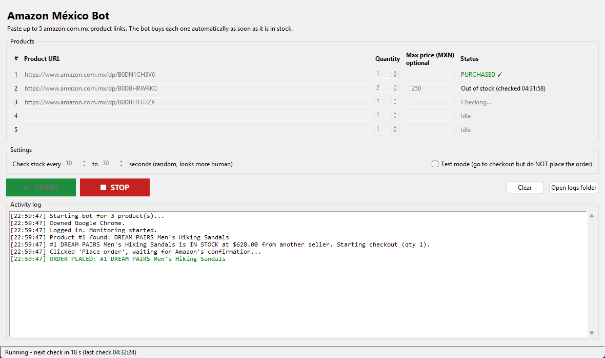
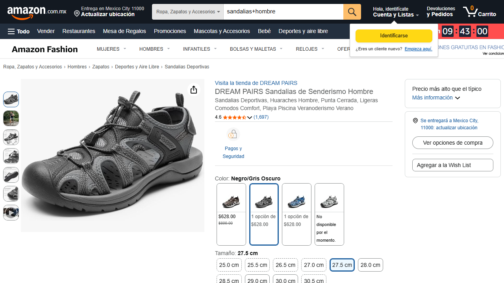
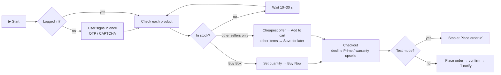
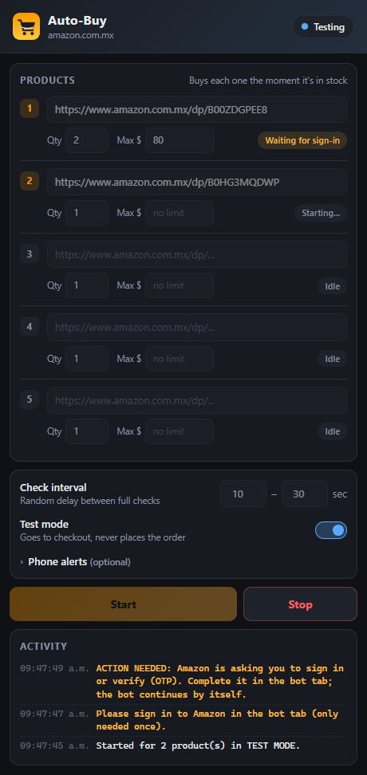

<div align="center">

# 🛒 Amazon México Auto-Buy Bot

**Monitor up to 5 amazon.com.mx products and buy each one the moment it comes back in stock.**




</div>

---

## ✨ Features

| | |
|---|---|
| 🎯 **5 product slots** | Paste any amazon.com.mx product link, with its own **quantity** and an optional **max price** |
| ⚡ **Instant checkout** | Buys each product as soon as it is in stock, using the account's default address and payment method |
| 🏪 **Any seller** | Uses *Buy Now* when there is a Buy Box. When there isn't one, opens **"Ver opciones de compra"** and buys the cheapest offer within the max price |
| 🧺 **Cart-safe** | Moves other cart items to *Guardar para más tarde* first, so only the monitored product is bought, in the exact quantity |
| 🔐 **Remembered login** | Uses a persistent Chrome profile, so you sign in once and *Keep me signed in* is ticked automatically |
| 🧑‍💻 **Human-in-the-loop** | If Amazon asks for a CAPTCHA, puzzle or OTP, the bot beeps, shows **ACTION NEEDED** and continues once you complete it |
| 🧪 **Test mode** | Goes all the way to the final *Place order* button **without** buying |
| 🌐 **Bilingual** | Works with Amazon in Spanish or English |
| 🕵️ **Human-like timing** | Random check interval (default 10–30 s) |
| 📸 **Audit trail** | Activity log, a log file and a screenshot of every order or failed checkout |

## 📸 Screenshots

<table>
<tr>
<td width="50%"><b>Desktop app</b><br></td>
<td width="50%"><b>Product with no Buy Box: bought via "Ver opciones de compra"</b><br></td>
</tr>
</table>

## ⚙️ How it works



Every product is bought **once**. If *Place order* was clicked but Amazon's confirmation can't be detected, the bot **does not retry**. It asks you to check *Mis pedidos*, so a product is never ordered twice.

## 🚀 Quick start (end user)

1. Download **`AmazonMXBot.exe`** and double-click it. If Windows SmartScreen appears, click *More info → Run anyway*.
2. Paste up to 5 product links and set the quantity (and optional max price) for each.
3. Tick **Test mode** for a first dry run, then press **▶ START**.
4. Sign in to Amazon in the Chrome window that opens. This is only needed the first time.
5. Leave it running. You get a beep and a pop-up for every order placed.

> **Requirements:** Windows 10/11 with Google Chrome (falls back to Microsoft Edge). Set your default shipping address and payment method in Amazon beforehand.

## 🧩 Chrome extension (alternative to the desktop app)

The same bot also comes as a **Chrome extension** in [`chrome_extension/`](chrome_extension). It runs inside your everyday Chrome, where you're already logged in to Amazon, so there's nothing to install apart from the extension.



**Install**
1. Open `chrome://extensions` and switch on **Developer mode** (top right).
2. Click **Load unpacked** and select the `chrome_extension` folder.
3. Pin the extension, open it, paste your product links and press **Start**.

**What's in it**
- The same features as the desktop app: Buy Box and *other sellers* buying, cart isolation, exact quantity, Test mode and a live activity log.
- It runs in its own **bot tab**. Keep that tab open (it can stay in the background).
- It skips **Kindle "1-Click"**, **pre-orders** and **back-orders** (*"No disponible por el momento"*), and reports a disabled payment step as *"add a payment method"*.
- **CAPTCHA / OTP:** it pauses, shows a desktop notification, focuses the tab and continues by itself once you've completed it.
- **Phone alerts (optional):** enter an [ntfy](https://ntfy.sh) topic and get a push on your phone for every order and every *action needed*.

<br clear="right">

## 🛠️ Build from source

```bat
git clone <this-repo>
cd amazon_bot
python -m venv .venv
.venv\Scripts\pip install -r requirements.txt

:: run the app
.venv\Scripts\python app.py

:: or build the single-file exe  →  dist\AmazonMXBot.exe
build.bat
```

No Playwright browser download is needed: the bot drives the Chrome or Edge already installed on the PC.

## 📁 Project structure

```
amazon_bot/
├── app.py            # Tkinter GUI: product slots, settings, start/stop, activity log
├── bot.py            # Engine: monitoring, login/CAPTCHA handling, cart & checkout (Playwright)
├── build.bat         # One-click PyInstaller build → dist\AmazonMXBot.exe
├── requirements.txt
├── README.txt        # Short how-to shipped to the end user
├── chrome_extension/ # Manifest V3 extension: popup UI, background worker, content script
└── docs/             # README images
```

**Local data** is stored in `%LOCALAPPDATA%\AmazonMXBot\`:

| Path | Contents |
|---|---|
| `browser_profile\` | Chrome/Edge profile holding the Amazon session |
| `settings.json` | Last-used product links, quantities and interval |
| `logs\bot.log` | Detailed log |
| `logs\screenshots\` | Screenshot of every order, test run and failed checkout |

## 🛡️ Safety by design

- **Confirmation dialog** before a live (non-test) run starts.
- **Test mode** can never place an order. Any checkout button whose label looks like a purchase button is treated as the final step.
- **Never clicks** *Continue with Amazon Prime* or any paid upsell. It always declines.
- **Exact quantity:** refuses to check out if the cart holds more units than requested.
- **No double orders:** an unconfirmed order is flagged for manual review instead of being retried.

## ⚠️ Disclaimer

This tool automates a personal Amazon account on the owner's own PC. Amazon changes its pages from time to time, which can require selector updates. Use it responsibly and in line with Amazon's terms of service.
